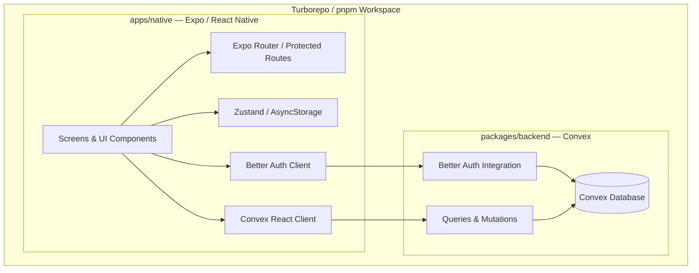
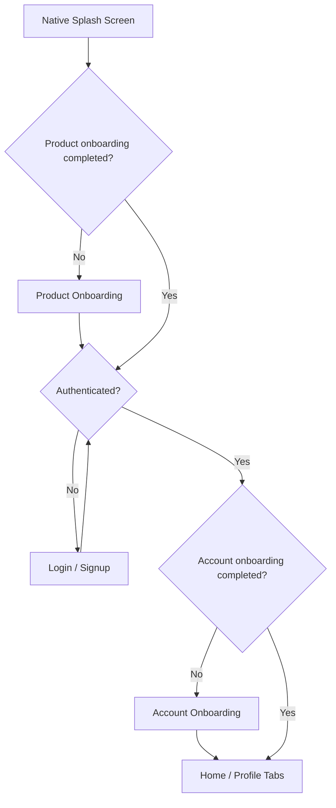

# kam-turbo-rn-cnv-start

A modern, full-stack React Native starter built with **Expo, TypeScript, Convex, Better Auth, and Turborepo**.

Designed as a scalable foundation for building mobile-first applications, with authentication, persistent onboarding, protected navigation, reactive backend operations, and maintainable UI conventions.

Originally scaffolded with [Better-T-Stack](https://github.com/AmanVarshney01/create-better-t-stack) and extended with a structured application architecture.

## Features

- **Expo & React Native** — Cross-platform mobile development with Expo Router.
- **TypeScript** — End-to-end type safety across the application and backend.
- **Convex** — Reactive backend with queries, mutations, and a typed API.
- **Better Auth** — Authentication integrated with Convex and Expo.
- **Protected navigation** — Authentication-aware routing using Expo Router's `Stack.Protected`.
- **Product onboarding** — Persistent, installation-level onboarding using Zustand and AsyncStorage.
- **Account onboarding** — Authenticated user onboarding persisted in Convex.
- **Profile & sign-out** — Authenticated profile screen with sign-out handling.
- **Theme support** — Light and dark themes with centralized semantic colors and design tokens.
- **Turborepo & pnpm** — Monorepo tooling and dependency management.
- **Varlock** — Environment schema validation and typed environment access.
- **ESLint & Prettier** — Code quality and consistent formatting.

## Tech Stack

| Layer | Technology |
|---|---|
| Mobile | React Native, Expo |
| Language | TypeScript |
| Navigation | Expo Router |
| Backend | Convex |
| Authentication | Better Auth, Convex Better Auth |
| State management | Zustand |
| Local persistence | AsyncStorage |
| Secure authentication storage | Expo SecureStore |
| UI | React Native primitives, Expo UI |
| Forms & validation | TanStack Form, Zod |
| Styling | React Native StyleSheet, centralized design tokens |
| Monorepo | Turborepo, pnpm |
| Environment management | Varlock |
| Code quality | ESLint, Prettier |

## Architecture

The project separates the Expo application from the Convex backend while keeping both within a single TypeScript monorepo.



### Architectural principles

- **Backend-driven data:** Convex is responsible for persistent application data and server-side business logic.
- **Authentication separation:** Better Auth manages sessions, while Convex authentication determines access to protected backend operations.
- **Local vs. remote state:** Zustand and AsyncStorage handle installation-level onboarding; Convex stores authenticated account-onboarding status.
- **Declarative navigation:** Expo Router's protected routes control access without imperative redirects for normal authentication transitions.
- **Modular UI:** Screens, reusable components, design tokens, and application logic have separate responsibilities.
- **Typed configuration:** Environment variables are validated and accessed through Varlock-generated types.

## Getting Started

### Prerequisites

Before starting, install:

- Node.js (a version compatible with the project's dependencies)
- pnpm
- Android Studio with an Android emulator, or Xcode with an iOS simulator
- A Convex account

You will also need a compatible Expo development environment.

### 1. Clone the repository

```bash
git clone <repository-url>
cd kam-turbo-rn-cnv-start
```

Replace `<repository-url>` with your GitHub repository URL.

### 2. Install dependencies

```bash
pnpm install
```

### 3. Configure Convex

```bash
pnpm run dev:setup
```

Follow the prompts to create or connect a Convex project.

Convex will generate the necessary deployment configuration and environment values.

### 4. Configure environment variables

Configure the Expo application environment using `apps/native/.env.schema` as the reference.

For the existing Convex integration, the application uses:

```dotenv
EXPO_PUBLIC_CONVEX_URL=<your-convex-deployment.cloud>
EXPO_PUBLIC_CONVEX_SITE_URL=<your-convex-deployment.site>
```

These are public client configuration values, not authentication secrets.

Configure the required Better Auth environment variables in the Convex deployment, including the authentication secret and application URL.

Keep secrets out of source control. Never place server-side secrets in variables prefixed with `EXPO_PUBLIC_`.

If an environment schema changes, regenerate its TypeScript accessor:

```bash
pnpm run env:generate
```

### 5. Start development

From the repository root:

```bash
pnpm run dev
```

This starts the development tasks configured for the monorepo.

To start only the Expo application:

```bash
pnpm run dev:native
```

Launch the application using the Expo development server and a compatible Android or iOS environment.

> Depending on the native dependencies and authentication configuration, a development build may be required instead of Expo Go.

## Application Flow

The starter implements a multi-stage onboarding and authentication flow.



### Product onboarding

- Displayed once per installation.
- Managed with Zustand.
- Persisted locally using AsyncStorage.
- Does not require authentication.

### Authentication

- Managed with Better Auth and the Convex integration.
- Login and signup screens are accessible to unauthenticated users.
- Authenticated Convex operations are gated by Convex authentication state.
- Navigation transitions are handled through Expo Router's protected routes.

### Account onboarding

- Displayed after authentication when the user has not completed account onboarding.
- Completion is stored in the Convex `userProfiles` table.
- Supports Continue and Skip actions.
- Persists across sessions and devices for the same account.

### Main application

After completing the required onboarding stages, authenticated users access the tab-based application.

The current implementation includes Home and Profile screens.

## Project Structure

```text
kam-turbo-rn-cnv-start/
├── apps/
│   └── native/
│       ├── app/
│       │   ├── (onboarding)/
│       │   ├── (auth)/
│       │   ├── (account-onboarding)/
│       │   ├── (tabs)/
│       │   ├── _layout.tsx
│       │   └── loading.tsx
│       ├── components/
│       ├── lib/
│       ├── src/
│       │   └── env.ts
│       └── .env.schema
├── packages/
│   └── backend/
│       └── convex/
│           ├── auth.ts
│           ├── convex.config.ts
│           ├── http.ts
│           ├── schema.ts
│           └── userProfiles.ts
├── turbo.json
├── pnpm-workspace.yaml
└── README.md
```

Additional application directories contain shared components, stores, theme utilities, and validation helpers.

## UI & Development Guidelines

The project follows a lightweight, native-first approach to UI development.

### 1. Prefer native-first UI

- Use React Native primitives such as `View`, `Text`, `Pressable`, and `StyleSheet` for general layout and composition.
- Prefer `@expo/ui` and its universal APIs when native controls provide a clear benefit.
- Introduce platform-specific implementations only when necessary.
- Avoid adding overlapping UI libraries prematurely.

### 2. Centralize styling and theming

- Use centralized design tokens for spacing, typography, border radii, and touch targets.
- Use semantic theme colors rather than hardcoding light and dark colors in screens.
- Support light and dark appearance consistently.
- Keep reusable styling separate from screen-specific layout concerns.

### 3. Follow platform conventions

- Respect safe areas and system UI.
- Support accessible touch targets and readable typography.
- Use appropriate accessibility roles, labels, and states.
- Account for dynamic text sizes and different screen dimensions.
- Prefer familiar iOS and Android interaction patterns.

### 4. Keep state responsibilities clear

- Use local component state for temporary UI interactions.
- Use Zustand for shared client-side state when necessary.
- Use Convex for persistent backend state and reactive application data.
- Avoid duplicating server state in local stores without a specific reason.

### 5. Keep navigation declarative

- Use Expo Router file-based navigation.
- Protect routes through `Stack.Protected`.
- Derive route access from authentication and onboarding state.
- Avoid manual redirects when protected route transitions can handle the flow.
- Account for asynchronous authentication and profile loading.

### 6. Maintain code quality

- Use TypeScript strict typing.
- Keep components focused and reusable.
- Validate user input using schemas where appropriate.
- Handle loading, empty, and error states explicitly.
- Avoid unnecessary dependencies and abstractions.
- Keep secrets out of the client bundle and repository.

### Optional UI libraries

Additional styling or component libraries should only be introduced when they offer a clear benefit:

- **NativeWind or Uniwind** for Tailwind-style development.
- **Unistyles** for performant, type-safe styling and theming without Tailwind.
- **React Native Reusables or HeroUI Native** for customizable, ready-made components.

The default approach remains React Native primitives and `@expo/ui`, avoiding unnecessary dependencies or overlapping UI systems.

## Environment Management

Each application owns its environment configuration through `.env.schema`.

Varlock generates typed environment accessors during installation and through:

```bash
pnpm run env:generate
```

Import the generated `ENV` accessor rather than accessing environment variables directly throughout application code.

Environment schemas should be committed, while sensitive values belong in ignored environment files or deployment configuration.

For additional information, see the [Varlock monorepo guide](https://varlock.dev/guides/monorepos/).

## Available Scripts

Run these commands from the repository root.

| Command | Description |
|---|---|
| `pnpm install` | Install workspace dependencies |
| `pnpm run dev` | Start monorepo development tasks |
| `pnpm run dev:native` | Start the Expo development server |
| `pnpm run dev:setup` | Configure the Convex development project |
| `pnpm run build` | Run configured workspace builds |
| `pnpm run check-types` | Run TypeScript checks across the workspace |
| `pnpm run env:generate` | Generate typed environment accessors |

## Development Workflow

A typical development cycle:

1. Start the development environment.
2. Make changes to the Expo application or Convex backend.
3. Verify TypeScript types and linting.
4. Test affected flows on the target platform.
5. Commit focused, working changes using conventional commits.

Example:

```text
feat(auth): add signup flow
feat(onboarding): persist account onboarding
feat(profile): add profile screen with sign-out support
fix(navigation): prevent authentication loading flicker
docs(readme): document project architecture and setup
```

## Project Status

This repository is an evolving application starter and reference implementation.

The current foundation includes authentication, product onboarding, account onboarding, protected navigation, basic tab navigation, profile management, and centralized UI conventions.

Additional application features can be built on top of this foundation without changing the underlying architecture.

## Acknowledgements

Originally generated using [Better-T-Stack](https://github.com/AmanVarshney01/create-better-t-stack).

Built with [Expo](https://expo.dev/), [Convex](https://www.convex.dev/), [Better Auth](https://www.better-auth.com/), and [Turborepo](https://turborepo.com/).